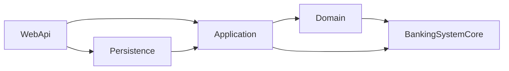
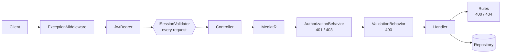
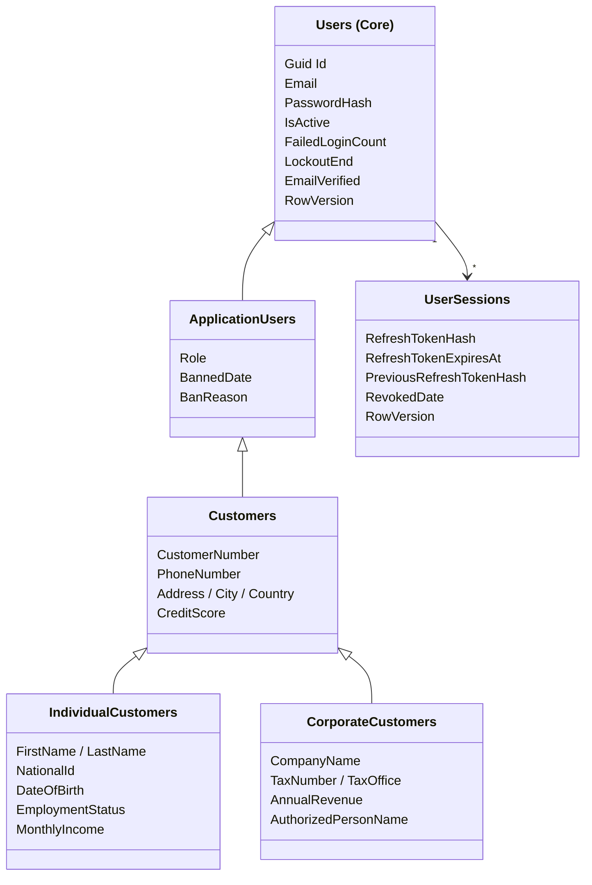
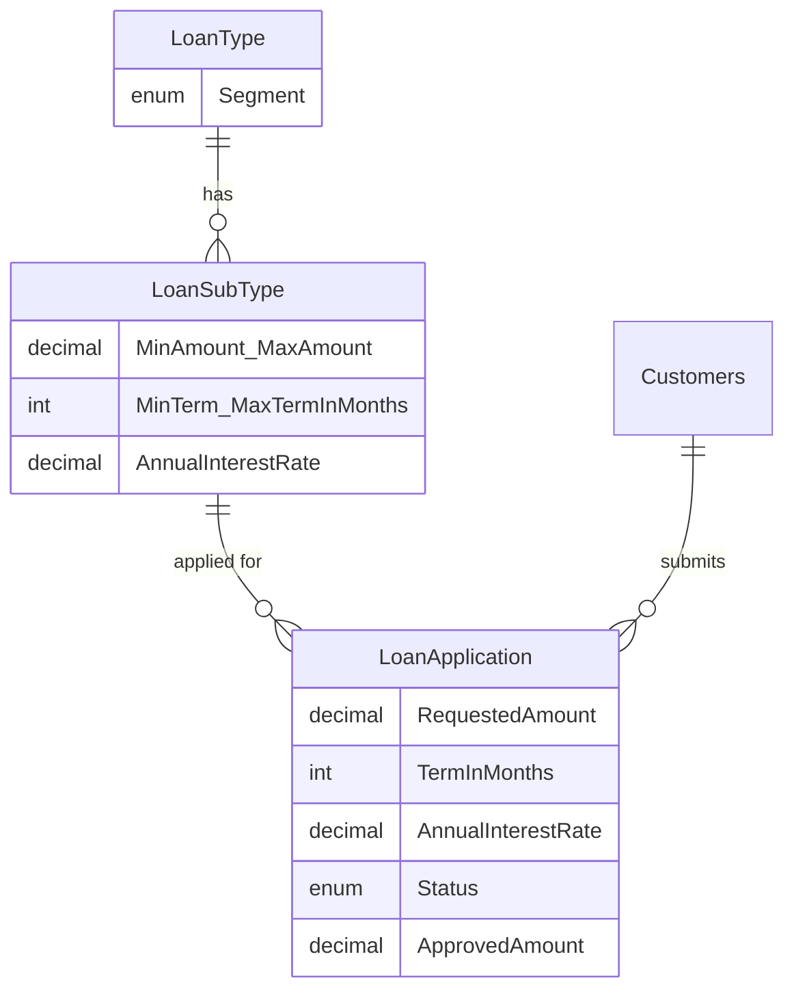
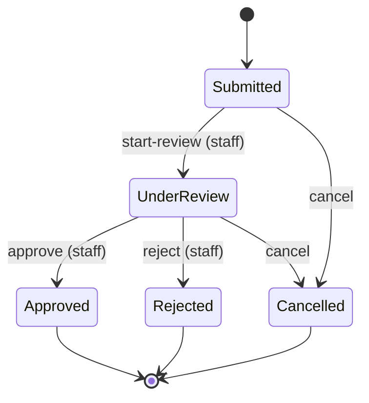
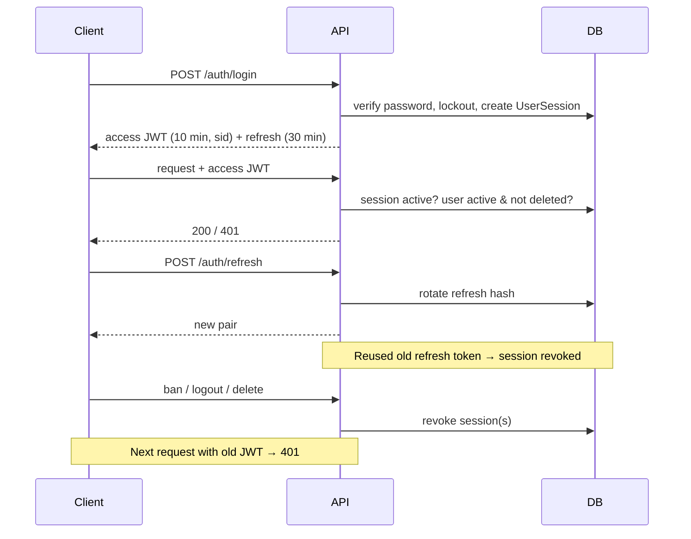
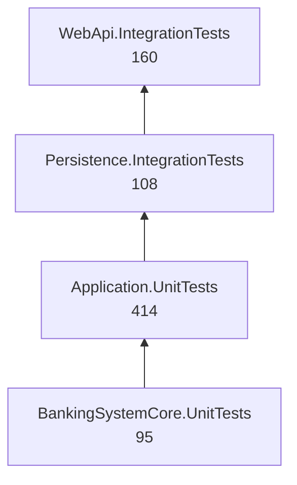

# ExampleBankApp – Loan Module

.NET 10 · C# · Clean Architecture · CQRS (MediatR) · EF Core 10 / SQL Server · JWT + server-side sessions.

Blueprint of the skeleton (architecture, security, tests, rules) for any product: [docs/PROJECT_BOOTSTRAP.md](docs/PROJECT_BOOTSTRAP.md)

## 1. Layers



| Project | Content |
|---|---|
| `BankingSystemCore` | Reusable kernel: `Entity<T>`, generic repository + EF impl, `Paginate<T>`, exceptions + middleware, JWT, hashing, `ICurrentUser`, mailing, `AuthorizationBehavior`. No product logic. |
| `Domain` | Entities + enums only. |
| `Application` | Commands, queries, handlers, FluentValidation, Mapperly mappers, rules, repository ports. |
| `Persistence` | `DbContext`, entity configurations, repositories, migrations. |
| `WebApi` | Controllers, auth setup, OpenAPI/Swagger, composition root. |

## 2. Request pipeline



- `ISecuredRequest` declares allowed roles (explicit interface → not in JSON/Swagger). Empty = any logged-in user.
- Ownership (`CustomerAccessPolicy`): other customer's record → 404, acting for another → 403.
- `SecurityContractTests`: every request is secured or on the explicit open list; roles pinned per request.

## 3. Data model

### 3.1 User chain (table-per-type, one insert writes the whole chain)



`customerId == userId == JWT sub`. Role is never read from a request: customers get `Customer`; staff only via `POST /api/v0/users/staff`.

### 3.2 Loans



Segment rule: individual customers → individual loan types; corporate → corporate.

### 3.3 Application status



Payment: annuity, `monthly rate = annual rate / 12`, no taxes/fees.

## 4. Authentication and sessions



| Mechanism | Value |
|---|---|
| Access token | JWT, 10 min, claims `sub`, `sid`, role |
| Refresh token | opaque, 30 min, single-use, SHA-256 hash stored |
| Password hash | PBKDF2-SHA256, 600k iterations (configurable) |
| Lockout | 5 failures → 15 min |
| Revocation | per-request session check → ban/logout/delete effective immediately |
| Concurrency | `RowVersion` on `User`, `UserSession` → stale write = 409 |
| E-mail verification | `IEmailSender` + `LoggingEmailSender`; token 24 h, single-use, hashed; `RequireVerifiedEmail=false` |

## 5. API

| Area | Endpoints | Access |
|---|---|---|
| Auth | `POST /api/v0/auth/login` `refresh` `logout` · `GET /api/v0/auth/me` · `POST /api/v0/auth/send-verification-email` `verify-email` | login/refresh/verify open |
| Users | `GET /api/v0/users` · `POST /api/v0/users/staff` · `POST /api/v0/users/{id}/ban` `unban` | staff |
| Individual customers | `POST` `GET` `GET {id}` `PUT {id}` `DELETE {id}` `/api/v0/individual-customers` | create/list/delete staff; get/update staff + own |
| Corporate customers | same under `/api/v0/corporate-customers` | same |
| Loan types | `GET/POST /api/v0/loan-types` · `POST /api/v0/loan-types/{id}/sub-types` | list: any; create: staff |
| Loan applications | `POST` `GET` `GET {id}` `/api/v0/loan-applications` · `GET .../calculate` · `POST .../{id}/cancel` | staff + own |
| Decisions | `POST /api/v0/loan-applications/{id}/start-review` `approve` `reject` | staff |
| Audit trail | `GET /api/v0/audit-logs` (filters: `actorUserId` `targetId` `action` `succeeded` `from` `to`) | staff |
| Health | `GET /health/live` · `GET /health/ready` (database) | anonymous |

The API is **version 0**: the version is part of the URL, an unversioned URL is a 404, and every response carries `api-supported-versions`. One OpenAPI document per version: `/openapi/v0.json`.

All lists are paged. Errors: `application/problem+json`.

| Exception | HTTP | `type` |
|---|---|---|
| Business | 400 | `urn:problem:business` |
| Validation | 400 | `urn:problem:validation` |
| Authentication | 401 | `urn:problem:authentication` |
| Authorization | 403 | `urn:problem:authorization` |
| NotFound | 404 | `urn:problem:not-found` |
| Conflict: a concurrent change (`DbUpdateConcurrencyException`) or a duplicate unique value two requests created at once | 409 | `urn:problem:conflict` |
| TooManyRequests (rate limit, with `Retry-After`) | 429 | `urn:problem:rate-limit` |
| other | 500 | `urn:problem:internal-server-error` |

## 5a. Host hardening and operations

Closed by default; everything is opened through configuration (environment variables use `__`, e.g. `Cors__AllowedOrigins__0`).

| Area | Behavior | Settings |
|---|---|---|
| Rate limit | Login, refresh and verify-email: per client address, fixed window. 429 problem+json with `Retry-After`. | `RateLimiting:Enabled` (true), `RateLimiting:AnonymousAuth:PermitLimit` (10), `WindowSeconds` (60) |
| Client address | `X-Forwarded-For/Proto/Host` are read **only** from listed proxies. Without a list only a proxy on the same machine is trusted, and the rate limit sees the proxy, not the client. | `ForwardedHeaders:KnownProxies`, `ForwardedHeaders:KnownNetworks` (CIDR) |
| HTTPS | HTTPS redirection and HSTS (1 year, subdomains) outside development. | – |
| CORS | No origin is allowed unless listed. | `Cors:AllowedOrigins` |
| Response headers | `X-Content-Type-Options`, `X-Frame-Options: DENY`, `Referrer-Policy`, `Cache-Control: no-store`, strict `Content-Security-Policy` (not on the Swagger page). No `Server` header. | – |
| Health | `/health/live` (process), `/health/ready` (database). Status text only. | – |
| Sessions | A background worker deletes sessions that ended more than 7 days ago, in batches. | `Security:SessionCleanup:Enabled`, `Interval` (01:00:00), `RetentionDays` (7), `BatchSize` (500) |

Account lockout (5 wrong passwords, 15 minutes) stops password guessing; the rate limit keeps one address from locking other people's accounts at speed. A distributed attacker can still lock accounts slowly: a CAPTCHA or an unlock mail is the usual next step.

## 5b. Audit trail

Every command that changes state is marked `[Audit("Action", "TargetType")]`; after it succeeds, the pipeline writes one row to `AuditLogs`: actor (id, e-mail, role), action, target (type, id), a short safe note (a reason, an amount), IP address, trace id and the time. Logins are recorded as well: success, refused password, lockout, reused refresh token. A failed request writes nothing. Passwords, tokens and national IDs never reach the trail.

- A test fails when a new command has neither `[Audit]` nor a place on the short, explained exception list.
- The rows have no foreign keys: the trail outlives deleted users and customers. They are never updated or deleted by the application; keep or archive them as your retention rules say.
- The row is written after the change is saved. If the store is down, the action still stands and the entry is logged at Critical level with all its fields.

## 6. Run

```bash
docker compose up -d                 # SQL Server + API
docker compose logs -f api
docker compose restart api           # after code changes
docker compose down [-v]             # -v drops the database
```

Swagger: **http://localhost:5043/swagger** (reads `/openapi/v0.json`) · SQL Server on `127.0.0.1:1433`.

- Dev env applies EF migrations on startup.
- Bootstrap staff (local only): `staff@bankapp.local` / `Staff_Passw0rd!`.
- Config via env vars (`ConnectionStrings__BankAppDb`, `Security__Jwt__SecurityKey` ≥ 32 bytes). Never commit real secrets.
- Migrations: `./scripts/ef.sh migrations add <Name> --output-dir Migrations`.

## 7. Tooling (no local .NET)

All commands run in `mcr.microsoft.com/dotnet/sdk:10.0`.

| Script | Purpose |
|---|---|
| `scripts/dotnet.sh <args>` | dotnet CLI |
| `scripts/ef.sh <args>` | dotnet-ef |
| `scripts/test.sh [--project <p>]` | tests (mounts Docker socket for Testcontainers) |

VS Code: Dev Containers → *Reopen in Container* (`.devcontainer/`).

## 8. Tests



xUnit v3 (MTP) · Shouldly · NSubstitute · Testcontainers.MsSql · Respawn · Mvc.Testing. Integration tests use a real SQL Server, reset between tests.

Rule: a behavior is asserted at the lowest level that can prove it. Database tests cover only what needs the real engine (queries, constraints, persisted state), HTTP tests only what needs the real host (routing, status codes, auth wiring). See [docs/PROJECT_BOOTSTRAP.md](docs/PROJECT_BOOTSTRAP.md) §11.

```bash
./scripts/test.sh                                            # all (777)
./scripts/dotnet.sh test --project tests/Application.UnitTests   # no Docker socket needed
```

### CI/CD

`.github/workflows/ci.yml`, on `ubuntu-latest`. On every pull request into `main`: restore, Release build, the whole test suite (`dotnet test --solution BankApp.slnx`; the integration tests start SQL Server through Testcontainers, Docker is preinstalled on the runner), then a Docker image build with a smoke test of `/health/live`. After a merge to `main` the image is also pushed to `ghcr.io`. There is no deploy step yet. A new push to the same pull request cancels the run in progress; the SDK version comes from `global.json`.

To block merging on a red build, protect `main` (Settings → Branches): require a pull request and the `build-and-test` and `docker-build` checks. Details and open items: [docs/CICD.md](docs/CICD.md).

## 9. Repository layout

```
BankApp.slnx · Dockerfile · docker-compose.yml · global.json
.github/   workflows/ci.yml
scripts/   dotnet.sh  ef.sh  test.sh
docs/      PROJECT_BOOTSTRAP.md  CICD.md
src/       BankingSystemCore  Domain  Application  Persistence  WebApi
tests/     BankingSystemCore.UnitTests  Application.UnitTests
           Persistence.IntegrationTests  WebApi.IntegrationTests
```

## 10. Not implemented yet

Caching · real e-mail provider · password change/reset · MFA for staff · e-mail change · JWT key rotation · loan/installment/payment lifecycle · national ID encryption/masking.

Before going live: a Dockerfile and a CI/CD pipeline (GitHub Actions), and the production values of the settings above.
