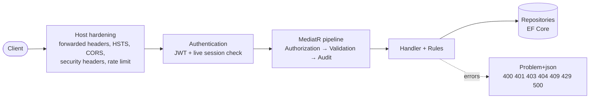
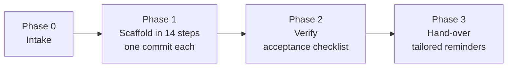
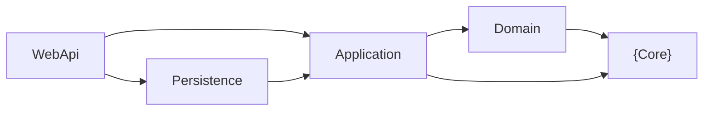
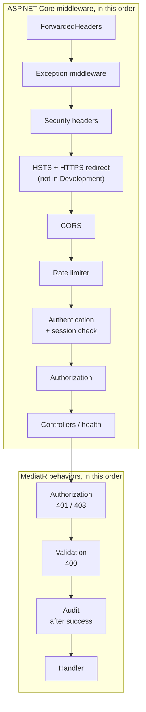
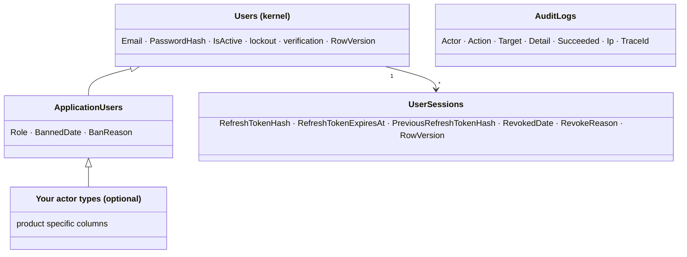
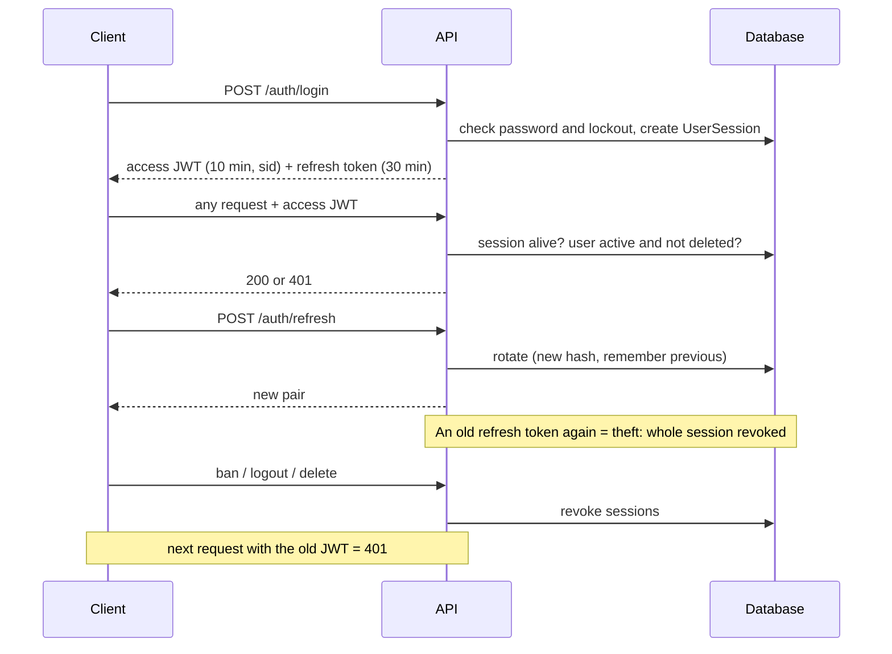
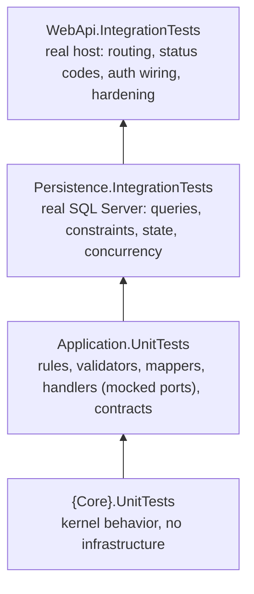

# Project Bootstrap Blueprint

A domain-free skeleton for secure, layered .NET back ends: **Clean Architecture + CQRS**, JWT with revocable sessions, audit trail, host hardening and a test suite that guards the architecture.

Hand this file to an AI agent (or a teammate) with a one-paragraph description of a product. The agent builds the whole skeleton, leaves the domain empty, and then reminds you of everything that was deferred.

```
You: "Read docs/PROJECT_BOOTSTRAP.md and bootstrap a project.
      Product: <name>. Context: <what it does, who uses it>."
```

Everything is written for a reader who has **not** seen the reference project. Names in `{braces}` are placeholders.

---

## 0. At a glance



| Pillar | What it gives you |
|---|---|
| Architecture | 5 projects, dependencies point inward only, a reusable kernel with no business words |
| Security | Short JWT + rotating refresh token, **instant revocation** (ban, logout, delete), lockout, PBKDF2, rate limit, secure defaults |
| Traceability | Audit trail of every state change and every login event |
| Operability | Health endpoints, versioned API (`/api/v0`), OpenAPI/Swagger, session cleanup worker, problem+json errors |
| Quality | Test pyramid, contract tests that fail when a rule is forgotten, deterministic time, real database in tests |
| Tooling | No local SDK needed: everything runs in Docker |

---

## 1. How to use this file



### Rules for the agent
1. **Intake first.** Ask the questions of section 2 in one message. Do not start before the answers.
2. **Domain stays empty.** Build every section of this file; add no product features. Offer one sample feature only if asked.
3. **One commit per step** of section 12 (`git add` only that step's files). Build and run the tests before each commit.
4. **Chat in the user's language; code, comments, docs and commit messages in English.**
5. **No secrets in the repository.** Dev defaults are labelled as dev-only.
6. **Keep the contracts.** Names of interfaces and behaviors in this file are part of the design; rename only through the placeholder table (section 3).
7. When something here is impossible (package missing, version clash), stop, say what, and propose the closest alternative. Never silently skip a section.
8. After the bootstrap, print the **tailored reminder list** of section 15.

### Two ways to share it
| Mode | How |
|---|---|
| **Agent mode** | Give this file + the context to an AI agent in an empty repository. |
| **Template mode** | Bootstrap once with the context "Example", clean the sample, mark the repository as a GitHub *template repository*. Friends click "Use this template" and still read this file for the why. |

---

## 2. Intake: what to ask before building

| # | Question | Default if unanswered | Changes |
|---|---|---|---|
| 1 | Product name (PascalCase) and kernel name | `{Product}`, `{Product}Core` | project names, namespaces, DB name |
| 2 | One paragraph: what it does, who uses it | – | feature folders later, role names |
| 3 | Who logs in? Names of the roles | `Admin`, `User` | `AppRoles`, role claim, contract test |
| 4 | Can end users sign themselves up, or are accounts created by an admin? | admin creates | whether a public sign-up endpoint exists |
| 5 | Database | SQL Server | provider package, health check, unique-violation detector, Testcontainers module |
| 6 | Multi-tenant? | no | tenant id column + query filter (not in skeleton, remind) |
| 7 | Does it store personal or financial data? | yes, assume | encryption/masking reminders |
| 8 | Where will it run? (cloud, on-prem, container platform) | undecided | Dockerfile, proxy and secret reminders |
| 9 | E-mail provider? | none (logging sender) | `IEmailSender` implementation, `RequireVerifiedEmail` |
| 10 | Expected scale / instances | one instance | cache and rate-limit store reminders |
| 11 | Source host and branch policy | GitHub, `main` protected, work on a feature/version branch | git steps |

Echo the answers back as a table and ask for a yes before step 1.

---

## 3. Placeholders and naming

| Placeholder | Example | Meaning |
|---|---|---|
| `{Product}` | `TodoApp` | solution name, DB name, volume names |
| `{Core}` | `AcmeCore` | reusable kernel project and root namespace (reuse it across products) |
| `{Roles}` | `Admin`, `User` | roles of the product (skeleton default) |
| `{Db}` | `TodoAppDb` | connection string name |

Projects: `{Core}`, `Domain`, `Application`, `Persistence`, `WebApi`; tests: `{Core}.UnitTests`, `Application.UnitTests`, `Persistence.IntegrationTests`, `WebApi.IntegrationTests`. Solution file: `{Product}.slnx`.

---

## 4. Architecture

### 4.1 Layers



| Project | Holds | May reference |
|---|---|---|
| `{Core}` | Reusable kernel: entity base, repository, paging, exceptions + middleware, pipeline behaviors, JWT, hashing, tokens, current user, mailing, security headers. **No product vocabulary.** | nothing |
| `Domain` | Entities and enums only | Core |
| `Application` | Features (commands, queries, handlers, validators, rules, mappers), ports (repository and service interfaces), security services | Domain, Core |
| `Persistence` | `DbContext`, entity configurations, repositories, migrations, provider-specific bits | Application |
| `WebApi` | Controllers, auth wiring, hardening, OpenAPI, composition root, background worker | Application, Persistence |

Rules: dependencies point inward only; the kernel references nothing of the solution; Application never references a database driver, ORM provider, HTTP client or mail library; controllers hold no business logic; each layer has exactly one `Add<Layer>Services` registration.

### 4.2 Request pipeline



| Behavior | Rule |
|---|---|
| Authorization | Runs **before** validation: an anonymous caller learns nothing about the request shape. Constrained on the base marker so result-less commands are covered too. |
| Validation | Stateless FluentValidation, grouped by property, converted to the kernel's library-free `ValidationException`. |
| Audit | Innermost. Writes only when the handler succeeded. |

### 4.3 CQRS conventions

- One request = one handler = one unit of work (one save).
- Commands change state, queries read. Entities never cross the Application boundary: requests in, response DTOs out.
- Anything the caller must not control (actor, role, timestamps, ownership) is resolved server side.
- Feature folder: `Features/{Feature}/{Commands|Queries}/{Name}/…`, plus `Constants/` (messages), `Profiles/` (mapper), `Rules/` (business rules, one class per feature).
- Business checks live in rule classes that throw typed exceptions; handlers call them.
- Mapping is compile-time (Mapperly, `RequiredMappingStrategy.Target`): an unmapped target member is a build error unless ignored on purpose.

---

## 5. The kernel (`{Core}`)

Build these, with these contracts. Namespaces are free; the shapes are not.

### 5.1 Data access

```csharp
public abstract class Entity<T> { public T Id { get; set; } = default!;
  public DateTime CreateDate { get; set; } public DateTime? UpdateDate { get; set; } public DateTime? DeleteDate { get; set; } }

public interface IAsyncRepository<TEntity, TId> where TEntity : Entity<TId> {
  Task<TEntity?> GetAsync(Expression<Func<TEntity,bool>> predicate, Func<IQueryable<TEntity>,IIncludableQueryable<TEntity,object?>>? include = null,
                          bool withDeleted = false, bool enableTracking = true, CancellationToken ct = default);
  Task<Paginate<TEntity>> GetListAsync(predicate?, orderBy?, include?, int index = 0, int size = 10, bool withDeleted = false, bool enableTracking = true, ct);
  Task<bool> AnyAsync(predicate?, bool withDeleted = false, ct);
  Task<TEntity> AddAsync(..); Task<ICollection<TEntity>> AddRangeAsync(..); UpdateAsync; UpdateRangeAsync;
  Task<TEntity> DeleteAsync(entity, bool permanent = false, ..); DeleteRangeAsync;
}
public class Paginate<T> { int Index, Size, Count, Pages; bool HasPrevious, HasNext; IList<T> Items; }
public interface IUniqueViolationDetector { bool IsUniqueViolation(DbUpdateException e); }   // provider project implements
```

- `EfRepositoryBase<TEntity,TId,TContext>(TContext, TimeProvider)`: every write saves immediately; stamps `CreateDate/UpdateDate/DeleteDate` from the injected `TimeProvider`; **soft delete** is the default (reads add `DeleteDate == null`, not a global filter, so rules can pass `withDeleted: true`); `GetListAsync` rejects `size < 1`.
- Include delegates use `IIncludableQueryable<TEntity, object?>` (nullable navigations).

### 5.2 Errors

| Exception (kernel) | HTTP | `type` | Notes |
|---|---|---|---|
| `BusinessException` | 400 | `urn:problem:business` | rule broken |
| `ValidationException` (+`ValidationExceptionModel{Property, Errors[]}`) | 400 | `urn:problem:validation` | grouped by property |
| `AuthenticationException` | 401 | `urn:problem:authentication` | |
| `AuthorizationException` | 403 | `urn:problem:authorization` | |
| `NotFoundException` | 404 | `urn:problem:not-found` | also used for "not yours" |
| `ConflictException` | 409 | `urn:problem:conflict` | also `DbUpdateConcurrencyException` and unique violations (generic message, never the index or value) |
| `TooManyRequestsException` | 429 | `urn:problem:rate-limit` | with `Retry-After` |
| anything else | 500 | `urn:problem:internal-server-error` | generic text; details only in the log |

`ExceptionHandler` (abstract, one method per type) → `HttpExceptionHandler` (writes RFC 7807 `application/problem+json` with `instance` and `traceId`) → `ExceptionMiddleware` (registered first after forwarded headers; rethrows if the response already started; resolves `IUniqueViolationDetector` optionally from the request services).

### 5.3 Security primitives

| Piece | Contract |
|---|---|
| `User` (kernel) | **Login information only**: `Email, PasswordHash, IsActive, FailedLoginCount, LockoutEnd, LastLoginDate, EmailVerified, EmailVerifiedDate, EmailVerificationTokenHash, EmailVerificationTokenExpiresAt, RowVersion` |
| `IPasswordHasher` | `Hash`, `Verify`. PBKDF2-HMAC-SHA256, default **600 000** iterations (configurable), random salt, format `PBKDF2-SHA256$iterations$salt$hash` so the cost can be raised later; constant-time compare; malformed hash → `false`, empty password → throws |
| `SecureToken` | `Generate()` (crypto RNG, URL safe, ≥ 32 bytes), `Hash(token)` (SHA-256 hex, 64 chars), `Matches(token, hash)` (fixed-time; missing or other-length hash → `false`) |
| `ITokenHelper` / `JwtHelper(IOptions<TokenOptions>, TimeProvider?)` | `CreateToken(TokenUser(Id, Email, Roles, ExtraClaims?, SessionId?))` → `AccessToken(Token, ExpiresAt)`; HS256; claims `sub, email, jti, role…, sid`; `CreateValidationParameters(options)` pins issuer, audience, lifetime, signature, **algorithm HS256 only**, `ClockSkew` 1 min |
| `TokenOptions` | `Issuer, Audience, SecurityKey (≥ 32 bytes), AccessTokenExpirationMinutes = 10, RefreshTokenExpirationMinutes = 30`; `IsValid` rejects weak keys and unreasonable lifetimes; validated on start |
| `ICurrentUser` | `IsAuthenticated, Id, Email, SessionId, Roles, IpAddress, IsInRole, FindClaim`; `HttpCurrentUser` reads the validated principal and the connection address |
| `ISecuredRequest` | `IReadOnlyCollection<string> Roles` implemented **explicitly** (never in JSON/Swagger); empty = any logged-in user |
| `AuthorizationBehavior<,>` | not logged in → `AuthenticationException`; role mismatch → `AuthorizationException`; one matching role is enough; constrained `where TRequest : notnull, ISecuredRequest` |
| `IEmailSender` + `LoggingEmailSender` | default sender logs "not sent" and writes the body only when `Mailing:LogBody` is true (dev) |
| `SecurityServiceRegistration.AddSecurityServices` | registers the above + `TimeProvider.System` (TryAdd); fails fast on a missing/weak key |

### 5.4 Pipeline extras and HTTP

| Piece | Contract |
|---|---|
| `[Audit("Action", "TargetType")]`, `IAuditDetail`, `IAuditTarget`, `AuditEntry`, `IAuditWriter`, `AuditBehavior<,>` | see section 8 |
| `SecurityHeadersMiddleware` + `UseSecurityHeaders(options)` | sets (if absent) `X-Content-Type-Options: nosniff`, `X-Frame-Options: DENY`, `Referrer-Policy: no-referrer`, `Cache-Control: no-store`, `Content-Security-Policy: default-src 'none'; frame-ancestors 'none'` (skipped for configured page paths such as `/swagger`); set in `OnStarting` so error responses get them too |

---

## 6. Domain and identity



- **Table-per-type** inheritance. Creating a specialized actor is one command and one save that writes every table of its chain; its id equals the user id equals the JWT `sub`.
- `ApplicationUser.Role` is an enum stored as int; **the role is never read from a request**: self-created or admin-created accounts get a fixed role, privileged accounts come only from a dedicated, protected command.
- `UserSession`, `AuditLog`: ordinary entities (`Entity<Guid>`); `AuditLog` has **no foreign keys**.
- Concurrency: `RowVersion` (`rowversion`) on `User`, `UserSession` and on every entity that two actors can change at once (state machines). A stale write → `DbUpdateConcurrencyException` → 409.
- Decimal money fields: explicit precision. Dates: UTC `DateTime`, date-only values as `DateOnly`.

Skeleton ships **only** `User`, `ApplicationUser`, `UserSession`, `AuditLog`. Product entities come later.

---

## 7. Authentication and sessions



| Mechanism | Rule |
|---|---|
| Access token | JWT, 10 min, always carries `sid`; useless without a live `UserSession` |
| Session check | `OnTokenValidated` asks `ISessionValidator` on **every** request (one indexed query). **Never cache it**: that would delay revocation |
| Refresh token | opaque, 30 min, single use, only its SHA-256 is stored, previous hash kept for reuse detection; every refresh extends by 30 min |
| Reuse | previous token presented again → session revoked, event audited |
| Lockout | 5 wrong passwords → 15 min lock; attempts while locked change nothing; success resets |
| Unknown e-mail | verify against a dummy hash so timing matches; same generic message |
| Password policy | ≥ 10 chars, upper, lower, digit; applied on **every** operation that sets a password |
| Race safety | login/refresh read the user with `enableTracking:false` and never write it back, so they cannot undo a ban |
| E-mail verification | token 24 h, single use, hash stored; `RequireVerifiedEmail` default `false`; admin-created accounts are pre-verified |
| Bootstrap | first privileged account from `Security:BootstrapAdmin:Email/Password` when none exists; remove the settings afterwards |

Endpoints (all under `/api/v0`): `POST auth/login`, `auth/refresh`, `auth/logout`, `auth/verify-email`, `auth/send-verification-email`; `GET auth/me`; `GET users`, `POST users/admins`, `POST users/{id}/ban`, `POST users/{id}/unban`. Anonymous: login, refresh, verify-email (rate limited).

Ownership rule (generic): *roles say who may run a request; an access policy says whose data it may touch.* A non-owner reading a record gets **404**; acting for someone else gets **403**.

---

## 8. Audit trail

- Mark every state-changing command: `[Audit("Area.Action", "TargetType")]`. After the handler succeeds, `AuditBehavior` writes who (id, e-mail, role), what, to what (id from the request's `Id`, else the response's `IAuditTarget`, else response `Id`), a short safe note (`IAuditDetail`, cut at 500 chars), IP, trace id, time.
- Failed requests write nothing. A failing audit store is logged at **Critical** with all fields and never fails the finished action.
- Security events are written by `SecurityAudit`: login success, refused password (reason word only), lockout, refresh reuse. Not stored: unknown e-mails and attempts on a locked account (anyone can send them).
- Never in the trail: passwords, tokens, personal identifiers.
- Read: `GET /api/v0/audit-logs` (privileged only) — filters `actorUserId, targetId, action (prefix), succeeded, from, to`, paged, newest first.
- Contract test: every `*Command` has `[Audit]` unless on a short, explained exception list.

---

## 9. Host hardening, API surface, operations

### 9.1 Defaults (all closed; configuration opens them)

| Area | Behavior |
|---|---|
| Forwarded headers | `X-Forwarded-For/Proto/Host` read **only** from `ForwardedHeaders:KnownProxies` / `KnownNetworks` (CIDR) |
| HTTPS | HSTS (1 year, subdomains) + redirect outside Development |
| CORS | no origin unless `Cors:AllowedOrigins`; methods GET POST PUT DELETE; headers `Authorization`, `Content-Type`; exposes `Retry-After`, `api-supported-versions` |
| Rate limit | policy `anonymous-auth` on login, refresh, verify-email: per client address, fixed window, 10 / 60 s, 429 problem+json + `Retry-After`; `RateLimiting:Enabled` |
| Server header | removed |
| Health | `GET /health/live` (no checks), `GET /health/ready` (database); anonymous; plain status text |
| Swagger / OpenAPI | Development only |
| Migrations | applied automatically in Development only |

### 9.2 API conventions

- **Version in the URL from day one**: `/api/v0/...` (`Asp.Versioning`: `[ApiVersion("0")]`, route `api/v{version:apiVersion}/…`, `AssumeDefaultVersionWhenUnspecified=false`, `ReportApiVersions=true`). One OpenAPI document per version (`/openapi/v0.json`, group name format `'v'VVV`). Breaking change → new version.
- Resource routes (nouns); non-CRUD transitions are sub-resources (`POST …/{id}/approve`).
- Enums serialize as strings. Every list is paged (`index`, `size` 1–100) with the `Paginate<T>` shape. Controllers carry `[ProducesResponseType]` for success and problem statuses.
- OpenAPI: Bearer scheme, lock icon only on protected operations, a realistic example for every request body (and a test that the examples are accepted by the API).
- Controllers: `[ApiController]`, `[Authorize]` (except the open endpoints), one MediatR call each, `FluentValidation` as the only field-rule source (`SuppressImplicitRequiredAttributeForNonNullableReferenceTypes`).

### 9.3 Background work

`UserSessionCleanupService` + `UserSessionCleanupWorker` (`BackgroundService`, `PeriodicTimer`): deletes sessions revoked or expired more than `RetentionDays` (7) ago, in batches (500) via `ExecuteDelete`; safe to run on every instance; errors are logged and the loop goes on; `Security:SessionCleanup:Enabled/Interval/RetentionDays/BatchSize`.

---

## 10. Persistence rules

| Rule | Detail |
|---|---|
| Configuration | one `IEntityTypeConfiguration` per entity, applied from the assembly; no attribute mapping |
| DB protects the data | unique indexes, foreign keys (`Restrict`), required columns, max lengths, check constraints; unique indexes also cover soft-deleted rows, so rules check with `withDeleted: true` |
| Concurrency | `rowversion`; never catch-and-retry blindly |
| Unique race | rules check first; the index decides; a violation becomes 409 through `IUniqueViolationDetector` (SQL Server: errors 2601 and 2627) |
| Time | only through `TimeProvider`. `DateTime.UtcNow` in `src` is a defect |
| Migrations | generated, reviewed, committed, **incremental** (`./scripts/ef.sh migrations add Name --output-dir Migrations`); never edit an applied one; applied by hand/pipeline outside Development |
| Seed data | inside migrations with fixed GUIDs; test fixtures re-seed it after every reset |
| Provider-specific bits | isolated (configurations + the detector + the health/test packages) so a provider change touches few files |
| TPT caveat | `ExecuteDelete/ExecuteUpdate` cannot target a derived table; use raw SQL or entities |

---

## 11. Tests: the part not to skip

### 11.1 Pyramid and rule



**Assert each behavior at the lowest level that can prove it.** A pure rule is proven by a unit test; database tests only for what needs the engine; HTTP tests only for what needs the host. A test whose every assertion is already made below and above is deleted. Tests are written **with** the code, not after.

Stack: xUnit v3 on Microsoft Testing Platform (`global.json`: `"test": {"runner": "Microsoft.Testing.Platform"}`), Shouldly, NSubstitute, Testcontainers (SQL Server), Respawn, `Microsoft.AspNetCore.Mvc.Testing`.

### 11.2 Shared test infrastructure (build first)

| Helper | Purpose |
|---|---|
| `SqlServerFixture` (collection fixture) | one throwaway SQL Server per run; `MigrateAsync` once; Respawn resets before each test with `TablesToIgnore = __EFMigrationsHistory`; **re-seeds reference data** after each reset |
| `IntegrationTestBase` | builds the real DI container (`ValidateScopes`, `ValidateOnBuild`), swaps `ICurrentUser`, `IEmailSender`, `TimeProvider`; `Send(request)`, `UsingDbContext`, `ScopedDb` (two contexts to play two requests against each other), `Resolve`, optional extra settings |
| `TestCurrentUser` | admin by default; `AsUser(id)`, `AsAnonymous()`, `UseSession(id)`; fixed IP |
| `TestClock` | starts at real time then **stands still**; `Advance`; no `Task.Delay` in tests |
| `CapturingEmailSender` | keeps mails so tests read verification links |
| `ApiTestBase` | `WebApplicationFactory<Program>` in Development; sets test connection string, JWT settings, password iterations = 10 (fast), **rate limit off, session cleanup off** (tests share one address and reset the DB); an admin client, an anonymous client, `ClientFor(token)`, `IssueTokenAsync(role)` (real signed token tied to a real session), optional extra settings |
| Unit `AuthFixture`, `FakeCurrentUser`, `TestClock`, `MappingContract` | fake clock + fake repositories; reflection helpers for mapper contracts |

### 11.3 Test catalog the skeleton must contain

**`{Core}.UnitTests`**
- Exception middleware: every exception type → status, `type`, body; concurrency → 409 without leaking table/row text; unique violation → 409 without index/value; other DB error and "no detector registered" stay 500; unexpected → 500 generic; response already started → rethrown; 429.
- JWT: claims, roles, `sid` present/absent; expiry; accepted before and refused after expiry; wrong key; wrong issuer/audience; tampered payload; `alg: none`; each invalid option (weak key, exactly 32 bytes valid, bad lifetimes, missing issuer/audience); defaults.
- Password hasher: roundtrip, wrong password, salted, never contains the password, stores algorithm+cost, uses the stored cost, malformed/tampered hash, empty password, default cost ≥ 600 000.
- `SecureToken`: random, URL safe, hash deterministic fixed length, `Matches` cases.
- `ICurrentUser`: claims, role claim types, case-sensitive roles, anonymous, no HTTP context, `sid`, non-GUID subject.
- `AuthorizationBehavior`: 401, 403, one role enough, no roles = any login, unsecured pass-through, **result-less command is protected**, handler not reached on failure.
- Registration: services resolve; weak key fails on first use; missing key fails; a real e-mail sender registered later replaces the logging one; hashing cost configurable.
- `LoggingEmailSender`: says "not sent"; body hidden unless `LogBody`.
- `AuditBehavior`: writes actor/action/target/detail/IP; target from request id, response id, `IAuditTarget`, empty id fallback; failure writes nothing; no attribute = nothing; failing store does not fail; note cut at 500.

**`Application.UnitTests`**
- `SecurityContractTests`: every request is `ISecuredRequest` unless on the explicit open list; the open list is really unsecured; only known roles; `Roles` is not a public property; a table pins the roles of each request; a coverage test fails when a request is missing from the table; request count asserted.
- `AuditContractTests`: every `*Command` has `[Audit]` or is on the explained list; queries never audited; action names unique; no `IAuditDetail` on requests carrying a password.
- Mapper contract per mapped feature: all command properties copied; system fields untouched on create and update; every entity property accounted for; responses only contain entity properties; **no secret** (`Password`, `Hash`, `RowVersion`, `Token`) in any response; round trip; paging copied; empty page.
- Rules (existence, uniqueness incl. soft-deleted rows, state transitions, limits, time-dependent boundaries with `TestClock`), validators (valid, empty, each field), handlers (success, each failure, "nothing saved" via `DidNotReceive`), ownership policy matrix (admin, own record, other's record = 404, acting for another = 403, no id, anonymous).
- Auth: login (token content, session, case/trim, same message for unknown and wrong, counters, lockout, unlock after expiry, inactive, verification required/optional), refresh (rotate, once only, reuse revokes, expired, revoked, banned, no user write), logout (idempotent), verify e-mail (hash only, expiry boundary, same message for every failure), ban/unban (self-ban refused, double ban, batches of sessions revoked), create admin, user list never exposes secrets, `SecurityAudit` events.
- Pipeline: `ValidationBehavior` (throws and skips handler, groups by property, passes when valid or no validators).

**`Persistence.IntegrationTests`**
- Schema: expected table list; one row per table of an identity chain; the kernel `Users` table holds login columns only; unique e-mail across all user types (also when rules are bypassed); unique business keys; FK `Restrict`; an entity with children cannot be deleted; decimals keep precision; a failed multi-table insert leaves no row anywhere.
- Concurrency: two contexts, second write refused (user, session, every state-machine entity).
- Sessions: login creates sessions; refresh rotates (still one row); reuse revokes and stores the reason; hash only in DB; revoked/expired are not alive.
- Repository stamps `CreateDate/UpdateDate/DeleteDate` from the clock; soft delete keeps the row.
- Unique detector against real errors (duplicate = yes, too-long value = no).
- Cleanup service (old revoked/expired deleted; live and recent kept; time passing; batches).
- Audit trail through the real pipeline: state-change flow, ban/unban/admin creation, no secret or personal id, failed requests leave nothing, logins/refusals/lockout, unknown e-mail leaves nothing, outlives deleted users, list filters/paging/order, 401/403.
- Option binding proofs (e.g. `RequireVerifiedEmail=true` changes login).

**`WebApi.IntegrationTests`**
- Authentication matrix: every protected route (including every route with an `{id}`) → 401 problem+json without a token; only login/refresh/verify-email are open; malformed token, tampered payload, wrong key, expired, wrong issuer/audience, `alg: none` → 401; unknown role → 403.
- Authorization matrix: admin-only routes → 403 for a normal user; ownership (404 for others, 403 acting for others); login → `me`; same message for unknown e-mail and wrong password; lockout.
- Sessions at HTTP level: refresh rotation, reuse kills session **and** access token, logout (only that session), ban/unban/delete take effect on the very next request, lists never show secrets.
- E-mail verification flows with the captured mail (link contains the escaped address, no password).
- Problem format for 400/401/403/404/409/429/500 and "no internal type names leak".
- OpenAPI: Bearer scheme, lock only on protected operations, request examples exist **and are accepted by the API**; Swagger UI reachable in Development.
- Versioning: unversioned URL = 404, `api-supported-versions` header, document paths all `/api/v0/`.
- Hardening: security headers on 200/401/404 (no CSP on the Swagger page); health endpoints; HSTS and forwarded-headers options; CORS open for a listed origin and closed otherwise; rate limit on login/refresh/verify-email but not on protected routes; cleanup worker deletes old sessions and keeps live ones; audit endpoint (who/what/where, filters, 400s, 401/403, no secrets).
- Races: simultaneous identical sign-ups → exactly one created, never a 500.

### 11.4 Habits

- Add a request → add its row to the role table, the audit attribute (or exception), validator, rule, mapper contract, tests at the right levels.
- Security tests get a **mutation check**: remove the protection once, see the test fail, restore.
- Time: inject `TimeProvider`; boundaries are tested with a fixed clock.
- No sleeping, no ordering between tests, no shared data; zero compiler warnings.

---

## 12. Scaffold order (one commit each)

| # | Step | Result |
|---|---|---|
| 1 | Repository basics: `.gitignore` (dotnet), `global.json`, `dotnet-tools.json` (dotnet-ef pinned), `{Product}.slnx`, empty projects with references, `.devcontainer`, `.vscode/settings.json` (exclude `bin/obj`), `scripts/*.sh`, `docker-compose.yml` | solution builds in Docker |
| 2 | Kernel: entity, repository + EF base, paging, exceptions + middleware | kernel tests |
| 3 | Kernel security: hashing, tokens, JWT, current user, authorization behavior, mailing, registration | kernel tests |
| 4 | Domain + Persistence: `User` chain, `UserSession`, configurations, context, first migration, `IUniqueViolationDetector` impl | schema tests |
| 5 | Application base: registration, validation behavior, repository ports, `AppRoles`, access policy, `ISessionValidator`, token issuer, session service, e-mail verification service | unit tests |
| 6 | Auth + Users features (section 7) with validators, rules, mappers, messages | unit + contract tests |
| 7 | WebApi: composition root, JWT auth + session check, controllers, problem responses, bootstrap admin | HTTP tests |
| 8 | API versioning + OpenAPI + examples | versioning/openapi tests |
| 9 | Host hardening (section 9.1) | hardening tests |
| 10 | Session cleanup service + worker | cleanup tests |
| 11 | Audit trail (section 8) | audit tests + contract |
| 12 | Test infrastructure + catalog completion (section 11) | counts recorded |
| 13 | README (visual, few words) + this blueprint kept in `docs/` | docs |
| 14 | Acceptance run (section 14) and tailored reminders (section 15) | hand-over |

Steps 2–12 interleave tests with code (write the test with the feature). Step order is dependency order.

---

## 13. Reference: tooling, versions, configuration

### 13.1 Tooling (no local .NET)

| File | Content |
|---|---|
| `scripts/dotnet.sh` | `docker run --rm [-it] -v $REPO:/src -v {product}-nuget-cache:/root/.nuget/packages -w /src -e DOTNET_CLI_TELEMETRY_OPTOUT=1 -e DOTNET_NOLOGO=1 mcr.microsoft.com/dotnet/sdk:10.0 dotnet "$@"` |
| `scripts/test.sh` | same, plus `-v /var/run/docker.sock:/var/run/docker.sock -e TESTCONTAINERS_HOST_OVERRIDE=host.docker.internal`; default `dotnet test --solution {Product}.slnx`; extra args pass through (`--project …`) |
| `scripts/ef.sh` | `docker run … dotnet tool restore && dotnet ef "$@" --project src/Persistence --startup-project src/WebApi`; optional `EF_DOCKER_NETWORK` and `ConnectionStrings__{Db}` to reach the compose database |
| `docker-compose.yml` | `sql` (SQL Server 2022, `platform: linux/amd64`, published on `127.0.0.1:1433` only, healthcheck) and `api` (SDK image, `dotnet run --project src/WebApi --no-launch-profile`, port 5043→8080, env: Development, dev-only JWT key, `Mailing__LogBody=true`, bootstrap admin, connection string); named volumes for data and an **external** NuGet cache volume |
| `.devcontainer/devcontainer.json` | SDK image, workspace mounted at `/src`, NuGet volume, `postCreateCommand: dotnet restore`, C# Dev Kit |
| `.vscode/settings.json` | `files.watcherExclude`, `search.exclude`, `files.exclude` for `bin/obj/TestResults`; `git.repositoryScanMaxDepth` |

Create the external volume once: `docker volume create {product}-nuget-cache`.

### 13.2 Package pins (reference values, .NET 10)

| Package | Version | Why pinned |
|---|---|---|
| MediatR | 12.5.0 | 13+ is commercial |
| Riok.Mapperly | 4.3.1 | free, compile-time (AutoMapper 14 has advisories, 15+ is paid) |
| FluentValidation (+DI extensions) | 12.2.0 | |
| Microsoft.EntityFrameworkCore, .SqlServer, .Design, HealthChecks.EntityFrameworkCore, JwtBearer, OpenApi, Mvc.Testing | 10.0.15 | EF/health 11.x targets net11 only |
| dotnet-ef | 10.0.15 | |
| Microsoft.IdentityModel.JsonWebTokens | 8.23.0 | |
| Asp.Versioning.Mvc / .ApiExplorer / .OpenApi | 10.2.1 / 10.2.1 / 10.2.3 | |
| Swashbuckle.AspNetCore.SwaggerUI | 11.0.1 | UI only; the document comes from the built-in generator |
| xunit.v3 | 4.0.3 | |
| Shouldly / NSubstitute | 4.3.0 / 6.2.0 | |
| Testcontainers.MsSql / Respawn | 4.16.0 / 7.0.0 | |

Check for newer **compatible** patch versions at bootstrap; never take a major that changes license or target framework without asking.

### 13.3 Configuration reference

| Key | Default | Notes |
|---|---|---|
| `ConnectionStrings:{Db}` | empty → startup fails | from env/secret store |
| `Security:Jwt:Issuer / Audience` | `{Product}` / `{Product}.Clients` | |
| `Security:Jwt:SecurityKey` | empty → startup fails | ≥ 32 bytes, **secret** |
| `Security:Jwt:AccessTokenExpirationMinutes / RefreshTokenExpirationMinutes` | 10 / 30 | |
| `Security:PasswordHashing:Iterations` | 600000 | 10 in tests only |
| `Security:EmailVerification:RequireVerifiedEmail / TokenLifetimeHours / LinkTemplate` | false / 24 / local URL | |
| `Security:BootstrapAdmin:Email / Password` | unset | first privileged account; remove afterwards |
| `Security:SessionCleanup:Enabled / Interval / RetentionDays / BatchSize` | true / 01:00:00 / 7 / 500 | |
| `Mailing:LogBody` | false | true writes mail tokens to the log: dev only |
| `ForwardedHeaders:KnownProxies / KnownNetworks` | empty | |
| `Cors:AllowedOrigins` | empty | |
| `RateLimiting:Enabled / AnonymousAuth:PermitLimit / WindowSeconds` | true / 10 / 60 | |

Environment variables use `__` (`Security__Jwt__SecurityKey`). Typed options are bound and validated on start. A committed file never holds a real secret.

---

## 14. Acceptance checklist (Phase 2)

| Check | Expected |
|---|---|
| `./scripts/dotnet.sh build` | 0 errors, **0 warnings** |
| `./scripts/test.sh` | all green; print the total per project |
| `docker compose up -d` then open `/swagger` | UI loads; `/openapi/v0.json` lists only `/api/v0/…` |
| `GET /health/ready` | `Healthy` |
| Log in as the bootstrap account, call `GET /api/v0/auth/me` | 200 |
| Ban a second user, reuse their old token | 401 on the very next request |
| `GET /api/v0/audit-logs` | shows the ban and both logins |
| `git status` | clean; one commit per step; no secret in history |
| Contract tests | fail when you add a command without `[Audit]` or a request without roles (try once, revert) |

---

## 15. Tailored reminders (Phase 3)

After the bootstrap and after the user states the product context, print this list **filtered by the intake answers**, grouped by *now / before first deploy / later*.

| Topic | Remind when | Why |
|---|---|---|
| Real signing key from a secret store; key rotation plan (`kid`, accept old+new) | before first deploy | a leaked key mints any role |
| Remove `BootstrapAdmin` settings and compose defaults (`SA_PASSWORD`, `JWT_KEY`, `Mailing__LogBody`) | before first deploy | dev conveniences |
| **Dockerfile + `.dockerignore`** (production image; compose runs `dotnet run` in the SDK image) | before first deploy | not part of the skeleton |
| **CI/CD**: build, test (Docker needed for Testcontainers), dependency and secret scanning, image build once and promote, migrations as an explicit deploy step, `main` protected (PR only) | before first deploy | not part of the skeleton |
| `ForwardedHeaders` known proxies/networks, `Cors` origins, `RateLimiting` limits | before first deploy, behind a proxy or with a front end | otherwise the limiter sees the proxy and CORS blocks the UI |
| Real e-mail provider, then `RequireVerifiedEmail` | when users sign themselves up | currently only a logging sender |
| Password reset/change, e-mail change, MFA for privileged roles | before real users | not in the skeleton |
| Encrypt or mask personal identifiers at rest and in responses; retention and erasure rules | when intake #7 = yes | privacy law |
| Audit retention/archiving | before the table is large | no job exists |
| Multi-tenancy (tenant id + query filter) | when intake #6 = yes | not in the skeleton |
| Cache (reference data only; **never the session check**), distributed cache and shared rate-limit store | when more than one instance | in-process state diverges |
| Structured logging, metrics, tracing (OpenTelemetry), alerting on Critical audit-write failures | before production | only health endpoints exist |
| Idempotency keys for retried creates, background jobs, request size limits | when the product needs them | not in the skeleton |
| Backups, database user with least privilege (the app does not need DDL outside migrations) | before production | operations |
| Provider change (e.g. PostgreSQL): re-implement unique detector, indexes with provider syntax, regenerate migrations | if intake #5 ≠ SQL Server | SQL Server specifics isolated in Persistence |
| Distributed attackers can still lock accounts slowly | before public launch | add CAPTCHA/unlock mail |

---

## 16. Gotchas learned the hard way

- MediatR 12: non-generic `IRequest` is **not** `IRequest<Unit>`; constrain behaviors on `notnull` (or `IBaseRequest`), or result-less commands skip them. A contract test caught this for authorization.
- `ReadFromJsonAsync` consumes the stream; tests read text once and parse.
- Respawn must ignore `__EFMigrationsHistory`, and reference data must be re-seeded after each reset.
- Mapperly with nullable navigations: keep navigations nullable and fail loudly in explicit mappers.
- `ExecuteDelete` does not work on TPT derived tables.
- Never cache the session check; revocation is the point.
- Rate-limit partition key needs the real client address; without trusted proxies it is the proxy.
- URL replacement in tests: replace `"/api/` and `$"/api/` in one pass, or the version doubles.
- `dotnet add package` of `*.EntityFrameworkCore` without `--version` may pick a net11-only package.
- A `DbUpdateConcurrencyException` is also a `DbUpdateException`: order the middleware cases accordingly.
- Interpolated SQL table names in tests trigger EF1002; suppress locally with a comment.

---

## 17. Rules that apply to every change

### Security stance
Secure by default (a request or endpoint is protected unless declared open; opening one is a reviewed decision) · defense in depth (transport, pipeline, handler each assume the others can fail) · least privilege (roles grant the minimum; privileged roles only through protected commands) · fail closed (missing config, unreadable claim, unknown role = deny).

### Code rules
| Area | Rule |
|---|---|
| Validation vs rules | structural checks (shape, ranges) are stateless and run in the pipeline, never touch the database; business rules need data and run in the handler through rule classes with constant messages |
| State machines | lifecycle entities expose an allowed-transition check; a request that leaves an invalid state fails with a business error; they carry a `rowversion` |
| DI | constructor injection only; scoped by default; singletons are stateless; time and randomness are injected (`TimeProvider`); Application never touches the HTTP context (use `ICurrentUser`) |
| Configuration | typed options, validated on start; sources layered: repository defaults → environment file → environment variables/secret store; the container is validated on build (`ValidateScopes`, `ValidateOnBuild`) |
| Secrets | never committed; dev defaults are labelled dev-only; bootstrap data comes from configuration and is removed afterwards |
| Responses | existence is not disclosed across ownership boundaries; secrets and hashes never appear in a DTO, log line or exception message (a test asserts it) |

### When you add something later
| Addition | Constraint |
|---|---|
| Cache | reference data only; expiry and an invalidation path; **never the session check**; shared store when more than one instance; cleared between tests |
| Rate limit | at the host, per policy; partition by client address (anonymous) or principal id; real address needs trusted proxies; limits configurable, off in tests |
| Observability | structured logs with trace id on every line and every error response; liveness and readiness separate; no secrets or personal data in logs |
| Background work | persisted trigger, idempotent, safe to retry, safe on every instance |
| New use case | request + handler + validator + rule + mapper + endpoint + tests at the right level + role-table row + `[Audit]` (or a reasoned exception) + README/docs |
| New open request, new role, new cross-layer reference | architectural decision: explicit review |

### Delivery (when the pipeline is built)
Stages: restore → build (warnings as errors) → unit tests → integration tests (needs a container runtime) → dependency and secret scan → package → deploy. Secrets come from the CI secret store. Schema changes are a deployment step run before traffic moves, backward compatible with the previous version (expand → migrate → contract). Images are built once and promoted; only configuration differs. Production never auto-migrates or seeds development data. Known-vulnerable packages fail the build.

### Documents
Rules change only by deliberate edit, in the same commit as the code that needs the exception. When a rule and the code disagree, fix one of them the same day.

---

## 18. Out of scope (on purpose)

Product entities and features · UI · payment/queue/search integrations · multi-tenancy · distributed cache · real e-mail provider · password reset and MFA · Dockerfile and CI/CD (reminded, built later on request) · data encryption at rest.
